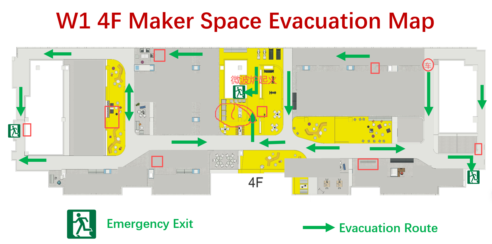

# IndoorFireWorld

## W1 4F 室内火灾感知与 UGV 闭环决策

微波炉电气故障场景下，UGV 在消防响应前获取室内观测，修正 World Model，并更新风险决策。

> 核心问题：新的 UGV 观测能否改变 World Model，并进一步改变可解释的路线决策？

**当前阶段：闭环机制已经跑通，正在将规划约束迁移到绿色有向疏散轨道。**

<p class="small">IndoorFireWorld · Implementation Progress · 2026-10-15</p>

---

# 系统闭环

## 从物理先验到路线决策

```text
W1 4F Registered Map
          ↓
Microwave Electrical Fire Scenario
          ↓
Physics Prior ──────── Hidden Ground Truth
          ↓                    ↓
     Initial Risk       UGV Observation
          ↓                    ↓
     Initial Route ← World Model Correction
                               ↓
                       Updated Risk Map
                               ↓
                       Updated Route
```

系统将以下概念分开建模：

- **Truth**：仿真中的隐藏真实火场，仅用于产生观测和离线评价。
- **World Model**：机器人在决策时能够使用的环境估计。
- **Hazard / Uncertainty / Cost**：物理危险、不确定度和规划代价分别计算。
- **Decision**：比较观测前路线与观测后的更新路线。

---

# 实现进度

| 阶段 | 实现内容 | 当前状态 |
|---|---|---|
| P0–P1 | 场景配置、语义层、占用层、导航层 | ✓ 完成 |
| P2 | 温度、烟雾、CO、能见度传播 | ✓ 完成 |
| P3 | UGV 单点观测与 World Model 融合 | ✓ 完成 |
| P4 | Hazard、Uncertainty、Planning Cost | ✓ 完成 |
| P5 | 风险感知 A* 路径规划 | ✓ 完成 |
| P6 | Observation-driven closed loop | ✓ 完成 |
| P7 | 消融、敏感性与可复现实验套件 | ✓ 完成 |
| Gate 1 | W1 4F 底图注册、三出口、微波炉、UGV 起点 | ✓ 完成 |
| Gate 2 | 四阶段微波炉电气故障 truth/prior | ✓ 完成 |
| P8 | Registered-map snapshot closed loop | ✓ 工程链路完成 |
| Gate 3 | 绿色箭头有向疏散路线图 | **下一步** |

**HPC 验证：110 tests passed，16 个 P8 正常矩阵案例成功生成。**

---

# 当前闭环证据

## P8 主案例：`t = 100 s`

| Posterior-field evaluation | Prior route | Updated route |
|---|---:|---:|
| Selected exit | Center stair | Center stair |
| Route length | 1.75 m | 1.75 m |
| Posterior cost | 4.6378 | 3.2805 |
| Integrated hazard | 0.04986 | 0.02271 |

```text
ΔJ = Jpost(prior route) − Jpost(updated route) = 1.3574
```

- Posterior cost 降低约 **29.3%**。
- Integrated hazard 降低约 **54.4%**。
- No observation：路线不变。
- Observation without fusion：路线不变。
- Normal fusion：路线发生变化。
- Truth oracle：`ΔJ = 2.9145`。

> 这组结果支持 observation → World Model correction → decision change 的因果链。

<p class="small">注意：上述路线来自当前自由栅格导航域，只作为闭环机制验证，不能作为最终 W1 疏散路线结果。</p>

---

# 已识别的路线建模缺口



## 当前模型

- A* 可以在所有 free cells 中移动。
- 路径可能横穿开放区域。
- 路径没有遵守绿色箭头方向。
- 几何可通行不等于实际疏散路线可行。

## 正确模型

- 将绿色箭头数字化为 **directed evacuation route graph**。
- 人员和 UGV 只能沿路线图的节点与边移动。
- 每条边记录方向、中心线和允许宽度。
- Hazard 与 uncertainty 沿图边采样和积分。
- 出口作为有向路线图终点。

> 因此，当前 P8 的软件链路有效，但路线 operational validity 需要 Gate 3 才能成立。

---

# 最终展示目标

## 一张主图讲清整个闭环

| A. Registered Map | B. Physics Prior | C. UGV Correction | D. Updated Decision |
|---|---|---|---|
| W1 底图 | Prior hazard | Observation residual | Posterior hazard |
| 绿色有向路线 | Initial route | Local WM update | Updated route |
| 起点、微波炉、出口 | Prior exit | Uncertainty change | 推荐原因与 ΔJ |

最终演示顺序：

1. 在 W1 4F 绿色路线图上显示 UGV 起点、观测点和出口。
2. 展示 physics prior 与 initial route。
3. UGV 获得温度、烟雾、CO 和能见度观测。
4. World Model 与 risk map 局部更新。
5. 规划器沿同一有向路线图重新计算路线。
6. 输出路线变化、风险变化和可解释推荐。

**最终结果形式：一张主图、一张结果表、一个动态演示、一个可复现代码包。**

---

# 我的工作与下一步

## 已完成的个人工作

- 将 W1 4F 场景转化为可计算的数字地图与语义配置。
- 构建微波炉电气故障的 truth/prior 双模型。
- 实现 UGV observation、World Model correction 与动态风险更新。
- 实现观测前后路线的 posterior counterfactual evaluation。
- 建立消融实验、HPC 自动验证和机器可读实验产物。

## 下一步

```text
Gate 3 绿色有向路线注册
          ↓
Graph-constrained route planner
          ↓
重新运行 4 times × 4 observation points
          ↓
Final P8 figure + table + demo
```

> 最终分工成果：一个在 W1 注册地图上运行、由 UGV 新观测驱动、并严格遵守绿色疏散轨道的可复现闭环决策系统。

<p class="small">研究边界：地图尺度、火灾参数与风险阈值尚未经过 W1 实测标定；P8 是 snapshot closed loop，不是 fully time-coupled robot–fire simulation。</p>
